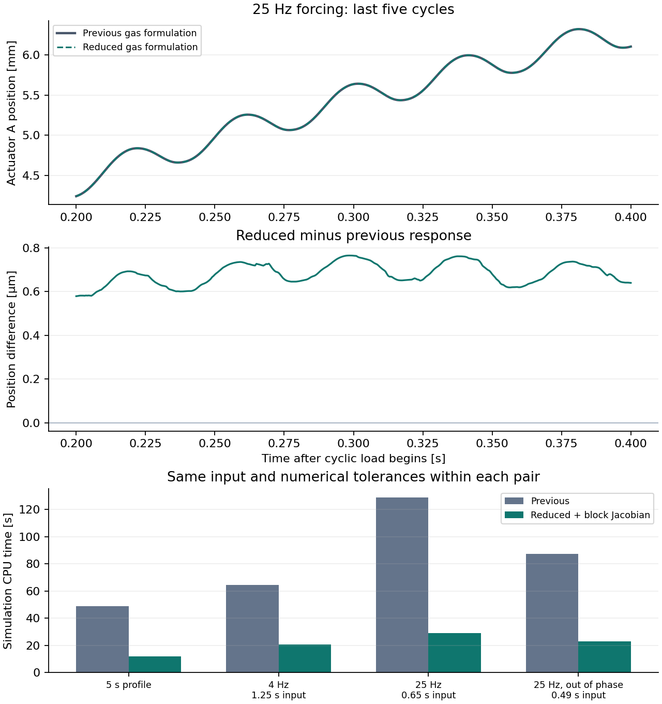

# Gas-network reduction and Jacobian optimization

This report records the gas-reduction stage **before** the subsequent
[restriction/noise calibration](restriction_calibration.md). The latter changed
the default curves, added restriction diagnostic channels and regenerated the
published outputs. Timings and frequency comparisons below describe the earlier
parameter set.

16 November 2026. The connected low-side gas was reduced first, followed by a
cheaper block Jacobian. The liquid remains incompressible. Wheel inertia,
restriction curves, friction, accumulator gas springs and the specified
10 kN/mm end stops are retained.

## Measured result

The complete **19-second** input finished in **299.81 seconds wall time**
(4 min 59.8 s), including imports, loading, sampled outputs and writing the
benchmark result. Simulation alone took 298.47 s; process CPU time for the
whole command was 296.14 s. This is about **2.3 times faster** than the
approximately 700 s reported by the user. That 700 s value is a user-reported
baseline, not a fresh full-duration reference timing in this investigation.

At completion of this stage the production source hash matched `gas_full19.json`. It used
`config/run.yaml`, including 70-bar initial blow-off gas pressure, three pipe
cells, six actuator wall cells, relative tolerance 1e-5 and maximum step 0.05 s.
The short configuration has also been synchronized to the full run's 70 bar.
The input force history is unchanged.

Frozen-source comparisons on shorter inputs were run sequentially:

| Input | Previous simulation wall / CPU | Reduced simulation wall / CPU |
| --- | ---: | ---: |
| Original first five seconds | 49.70 / 48.95 s | 12.09 / 11.97 s |
| Four cycles at 4 Hz after a 0.25 s ramp (1.25 s total) | 65.12 / 64.48 s | 20.60 / 20.44 s |
| Ten cycles at 25 Hz after a 0.25 s ramp (0.65 s total) | 130.45 / 129.05 s | 29.22 / 28.91 s |
| Six cycles at 25 Hz, actuators 90° apart (0.49 s total) | 88.23 / 87.45 s | 23.17 / 22.97 s |

These table values cover `simulate()` including sampled outputs, and exclude
imports/loading/file writing. Whole-command times are recorded separately.
Machine conditions vary between runs, so the table and full-run results should
not be extrapolated into a universal speed factor. A separate normal CLI short
run completed in 11.50 s end to end and matched the validated output exactly.



## Reduced equations

The actuator gas chambers, junction, pipe cells and reservoir now share one
pressure and total internal energy. Each retains a separate gas mass and
temperature; chamber boundary-layer energy states and all wall/piston thermal
states remain. This retains thermal history and conservative gas transport
without independent nanosecond pressure-relaxation modes.

For the connected network, with `k = gamma - 1`:

```text
P       = k * Utotal / Vtotal
dUtotal = sum(Qi) - P * sum(dVi)
dP      = (k*dUtotal - P*sum(dVi)) / Vtotal
Ui      = P*Vi / k
dUi     = (Vi*dP + P*dVi) / k
```

The local first law determines net incoming enthalpy:

```text
Hi = dUi - Qi + P*dVi
```

The gas network is a tree. Its branch enthalpy fluxes therefore follow directly
from these node balances. Dividing each flux by its smoothly selected donor
enthalpy determines mass flow. Every edge transfers equal and opposite mass
and energy. The reservoir mass is reconstructed from conserved total network
mass; the main and blow-off gas masses are constant. The standard model now
has **72 integration states**, down from 81.

The main and blow-off gases remain separate closed ideal-gas springs, including
compression work and heat transfer. The main piston remains eliminated by the
incompressible liquid-volume constraint. No extra mechanical freedom or liquid
pressure/compression state was introduced.

## Jacobian changes

This is a **block approximation to the Newton Jacobian**, not a claim of a
complete analytic state Jacobian:

- Gas-energy columns use bulk-energy perturbation scales. The former extremely
  small pressure-offset energy perturbations are no longer needed.
- The full RHS still solves the differentiated thermal liquid-volume constraint
  and its friction-heat coupling. While constructing a Newton matrix, its weak
  thermal-volume acceleration coefficients are held at the current state,
  retaining their acceleration dependence. This avoids repeatedly rebuilding
  that inner linearization for every matrix column.
- Gas-mass/boundary-energy and eligible solid-temperature perturbations reuse
  unchanged liquid/mechanical results and recompute only the gas/thermal block.
- Mechanical position/velocity perturbation floors were reduced to 1e-9 m and
  1e-9 m/s to better resolve the retained zero-flow transitions.

The integrator's Newton iterations still target the complete physical RHS.
Solver tolerances were not relaxed. Tests compare the reused block with complete
frozen-coefficient evaluations, and compare directional derivatives with the
full physical RHS at rest, during opposing motion and during faster motion.

## Accuracy and frequency checks

The frozen pre-change implementation is stored in
`gas_reference_before_reduction.zip`, with source/archive hashes in the matching
JSON. The validation driver runs that code and current code in separate Python
processes against identical input samples and settings. All inputs and generated
run configurations are under `gas_validation/`.

| Case | Maximum piston difference | Maximum pressure difference | Maximum temperature difference | Actuator A fitted amplitude change | Fitted phase change |
| --- | ---: | ---: | ---: | ---: | ---: |
| First five seconds | 0.927 µm | 0.0222 bar | 0.0584 °C | — | — |
| 4 Hz | 0.726 µm | 0.0184 bar | 0.0347 °C | +0.0163% | +0.00975° |
| 25 Hz, symmetric | 0.888 µm | 0.0160 bar | 0.0857 °C | +0.0305% | −0.00052° |
| 25 Hz, asymmetric | 0.673 µm | 0.0112 bar | 0.0924 °C | +0.0135% | +0.00532° |

Harmonic amplitude and phase are least-squares fits over the latter half of
each cyclic record, removing a constant and linear trend. These are comparisons
of transient responses, not claims of experimentally verified steady-state
transfer functions. Cyclic amplitudes are ±3000 N around +5000 N, with a smooth
one-cycle amplitude onset. High-frequency tests use 80 input samples per cycle
and initially cap steps at 40 per cycle.

A separate asymmetric 25 Hz run using the production 0.05 s maximum-step
setting also resolved the motion. Compared with the 0.001 s cap, differences
were at most **0.132 µm**, **0.00532 bar** and **0.00071 °C**; adaptive integration
reduced its actual steps as needed.

A further five-second check used the **complete numerical Jacobian**, relative
tolerance 1e-6, absolute tolerances reduced tenfold and maximum step 0.025 s.
Compared with the normal reduced model it differed by at most **0.462 µm**,
**0.00290 bar** and **0.00363 °C**. This supports retaining the cheaper Newton
matrix at the original tolerances. It took 43.24 s for simulation and sampling.

The complete 19-second output was also compared with the user's saved output:
maximum differences were **0.927 µm**, **0.0231 bar** and **0.0584 °C**. The saved
output matches the time/force history and initial 70-bar blow-off pressure but
has no stored original source/configuration hash, so its provenance is less
strict than the frozen-source short comparisons.

## Conservation and approximation limits

All **83 tests pass**. Gas tests verify local/global mass and energy conservation,
donor behavior through flow reversal, adiabatic compression and expansion,
common-pressure consistency, and independent thermal histories. Existing tests
continue to cover liquid continuity, the eliminated main piston, force signs,
friction, gas compression and elastic stops.

For the full run all outputs are finite. Maximum liquid-volume residual is
3.38e-21 m³, liquid mass drift is −5.55e-16 kg, and nitrogen mass drift is zero
at reported precision. The sampled energy-audit residual peaks at 1.414 J;
the existing 5 ms output quadrature and thermal-expansion work approximation
still limit interpretation of that audit as a solver-error measure.

The shared-pressure approximation **neglects connected-gas pressure loss and
acoustic/inertial transients**. Gas compressibility and thermal behavior remain.
Estimated omitted Darcy pressure differences peak at approximately 0.131% of
absolute gas pressure in the symmetric 25 Hz test and 0.0853% in the asymmetric
test. Maximum estimated Mach numbers are 0.0175 and 0.0136 respectively.

An additional screening estimate, `rho*L/A * d(volume_flow)/dt` from sampled gas
flows, gives omitted inertial pressure fractions of approximately 0.755% and
0.667% in those tests. These small estimates support this reduction for the
tested geometry/load amplitudes, but they do not bound resonant acoustic
effects. The old reference also omitted gas inertia: agreement with it is a
numerical/model-reduction check, not experimental validation of gas dynamics
through 25 Hz. Reassess gas-line effects if geometry or operating amplitudes
change substantially, or if measurements show a resonance in the operating band.

## Alternatives assessed

- Broader zero-flow smoothing gave no worthwhile improvement. The original
  transition scales were restored: 1e-11 m³/s for liquid and 1e-8 kg/s for
  gas/boundary transport. The physical curves and friction scale were retained.
- Fully refreshing the dominant mechanical Jacobian columns changed the 4 Hz
  solve from 23.46 to 23.33 s, within timing variation. The cheaper approximation
  was retained. Its experimental source is archived separately for review.
- Radau and LSODA remained slower on the reduced model in exploratory tests.
  BDF remains the production solver.

The full run still spends substantial time in mechanical/thermal RHS evaluations
and numerical matrix construction. A complete analytic state Jacobian or compiled
RHS remains an avenue for additional speed; neither is claimed as implemented here.

## Reproduction

```powershell
python -m gas_spring.cli --physical config/physical.yaml --run config/run_5s.yaml --simulate --diagnostics
python examples/benchmark.py --run config/run.yaml --label gas_full19_repeat
python examples/validate_gas_reduction.py
python -m pytest -q
```

The benchmark writes separate artifacts and preserves the full-run user output.
The validation archive is historical test code, not a selectable production
gas or liquid mode. Longer reference tests take time: the original ten-cycle
asymmetric reference exceeded a 180 s limit, so the completed asymmetric
comparison uses six cycles. Completed-case durations and any timeouts remain
recorded in `gas_validation/runs.json`.
