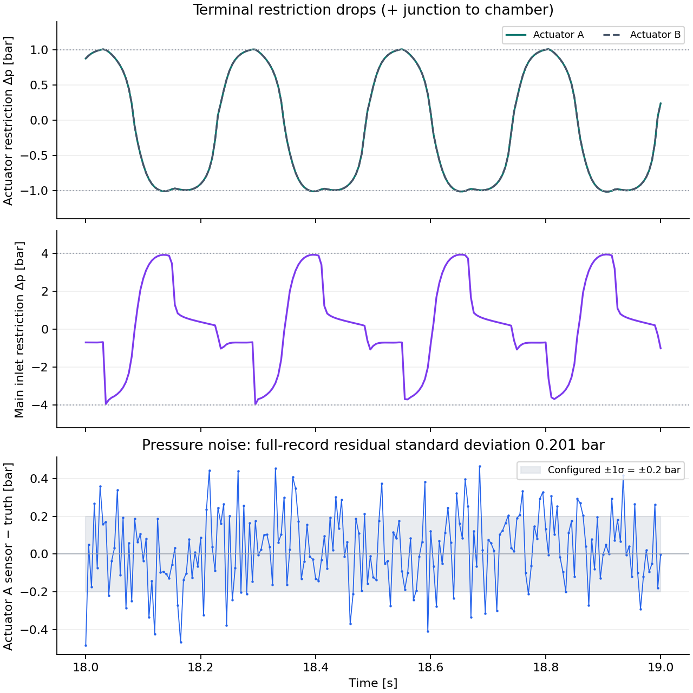

# Pressure noise and restriction calibration

16 November 2026. Pressure-sensor white-noise standard deviation is now
**0.2 bar** on all five pressure channels. The existing drift setting remains
0.005 bar/√hour. The restriction curves were calibrated to the user's **1 bar
per actuator / 4 bar main-inlet** targets, using the peak flows in each direction
over **18–19 s** of the full test input.

The existing model had higher restriction losses, approximately 16–18 bar near
the end. The user confirmed that the 1/4 bar targets should be used, so this
calibration reduces the restriction strengths. It does not increase damping.

## Verified full-run result

The final full 19-second solve used the production tolerances (rtol 1e-5,
unchanged absolute tolerances, maximum step 0.05 s). It completed in **292.10 s
wall time**, including imports/loading and result writing, with 287.63 s process
CPU time. The benchmark is `restriction_calibrated_3.json` / `.parquet`.

| Restriction and flow direction | Previous terminal peak | Final terminal peak | Piston velocity at final pressure peak | Flow at final pressure peak |
| --- | ---: | ---: | ---: | ---: |
| Each actuator, into chamber | 16.441 bar | **1.009 bar** | −0.1959 m/s | +11.52 L/min |
| Each actuator, out of chamber | 16.004 bar | **1.013 bar** | +0.1304 m/s | −7.67 L/min |
| Main inlet, into main chamber | 11.136 bar | **3.933 bar** | −0.1515 m/s | +14.46 L/min |
| Main inlet, out of main chamber | 18.404 bar | **3.976 bar** | +0.3179 m/s | −30.34 L/min |

The actuator curves are shared by A and B; their responses coincide in this
symmetric input. All four directional peaks are within **1.7%** of the targets.
The drops are evaluated from noise-free model pressures across each restriction.
These operating-point targets are not constant-pressure limits: other flow rates
and load histories produce different losses.



## How the fit was performed

The original speed points (0.15 and 0.8 m/s), each curve's force ratio,
digressive shape and 95% high-flow-tail setting were retained. The force
ordinates were multiplied by independent positive gains for each flow direction:

| Curve | Gain relative to previous configuration | New equivalent force points [N] |
| --- | ---: | --- |
| Actuator compression | 0.0223533 | 89.4133, 134.1199 |
| Actuator extension | 0.0209016 | 104.5078, 146.3109 |
| Main-inlet compression | 0.0809540 | 323.8161, 485.7242 |
| Main-inlet extension | 0.0584965 | 292.4824, 409.4754 |

Both existing speed/force parameterizations use the **actuator annular area**
(38 mm piston, 14 mm shaft) as their equivalent reference piston. The fit uses
actual restriction pressure differences and flows, rather than interpreting the
main-inlet force coordinates as forces on the physical main piston.

Opening the restrictions increased velocity substantially. Simply scaling the
old pressure drops gave approximately 2.65–2.88 bar at the actuators and
14–15 bar at the main inlet in the first rerun. Gains were therefore refined
against the resulting dynamics. Two exploratory runs used looser tolerances
to accelerate fitting, followed by the complete production-tolerance verification
above. Production solver settings were not relaxed.

Candidate physical configurations and the fit history are saved under
`restriction_calibration/`. `final_physical.yaml` matches the parsed production
`config/physical.yaml` exactly. The user-supplied targets are provisional
engineering calibration points, not measured hardware validation.

## Pressure-sensor noise verification

The final simulated pressure measurements have these sensor-minus-truth sample
standard deviations across all 3801 samples:

| Pressure channel | Residual standard deviation |
| --- | ---: |
| Actuator A fluid | 0.2011 bar |
| Actuator B fluid | 0.2048 bar |
| Low-pressure gas | 0.1971 bar |
| Main gas | 0.2029 bar |
| Blow-off gas | 0.1967 bar |

The small variation around 0.2 bar is consistent with finite random samples.
White noise is Gaussian, so individual deviations can exceed ±0.2 bar. Sensor
regeneration with the configured seed reproduces the saved measurements exactly.

## Additional damping and approximation checks

The specified **1 m × 4 mm hydraulic pipe** still contributes significant
resistance. Its calculated resistive drop peaks at **31.00 bar** in the final
second. The total pipe pressure difference peaks at 32.05 bar; the inferred
inertial component peaks at 8.97 bar at a different time. These maxima are not
additive. The pipe, seal friction and piston forces are additional to the
calibrated valve drops; comparing actuator fluid pressure with main gas pressure
does not isolate either valve.

The pipe is now a dominant damping source. Its bore, length and the fluid
viscosity assumptions are the next quantities to check against the real system
if the overall response remains inconsistent with observations. They were not
changed to force the valve targets.

The larger motion raises the reduced gas network's estimated omitted pressure
drop to **0.222 bar**, or **1.50%** of its absolute pressure, with estimated Mach
number 0.0685. The common-pressure gas approximation is therefore less accurate
than in the earlier high-damping comparison. These remain screening estimates;
the earlier 25 Hz comparison used the previous restriction settings and should
not be treated as a new validation of these lower-damping parameters.

All output values are finite and minimum absolute liquid pressure is 36.013 bar.
Liquid-volume residual is at most 3.85e-21 m³, liquid mass drift is −2.78e-17 kg,
and total nitrogen mass drift is zero at reported precision. Restriction
dissipation remains non-negative and agrees with signed pressure drop × flow.
Maximum actuator extension is 32.47 mm (50 mm travel); maximum blow-off travel
is 27.68 mm (50 mm travel). All **83 tests pass** with the calibrated parameters.

## Outputs and inspection

The verified full result is published to `examples/output.parquet`; the earlier
file is preserved at `examples/benchmarks/output_before_restriction_calibration.parquet`.
The five-second output was also regenerated with the new configuration.

The simulator now emits dedicated restriction channels for each of
`actuator_a`, `actuator_b` and `main_accumulator`:

```text
truth_<name>_restriction_pressure_drop_bar
truth_<name>_restriction_flow_m3_s
truth_<name>_restriction_dissipation_w
```

Positive drop/flow is from the hydraulic junction into the chamber; negative
values describe the reverse direction. Dissipation is positive in either case.

```powershell
python -m gas_spring.cli --physical config/physical.yaml --run config/run.yaml --simulate --diagnostics
python examples/plot_restriction_calibration.py
```

`examples/calibrate_restrictions.py --fast-fit` reproduces the fitting workflow
using the saved starting configuration and reference result. It writes candidate
configurations and verified results without overwriting the production YAML.
